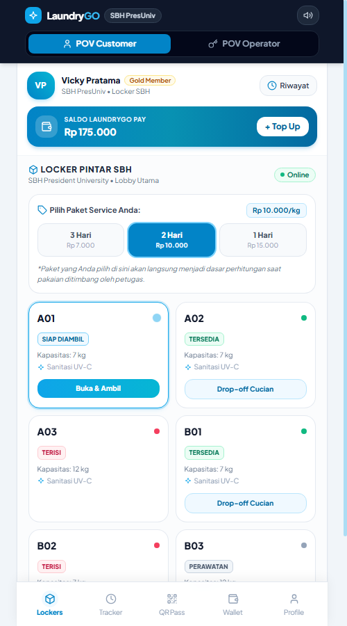
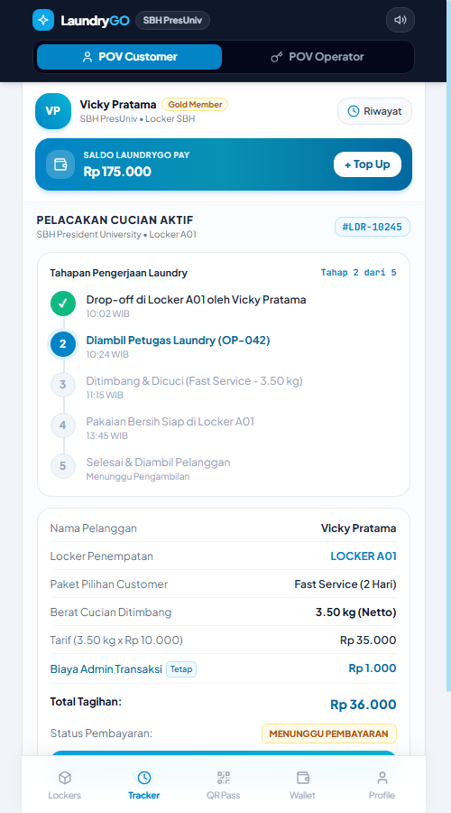
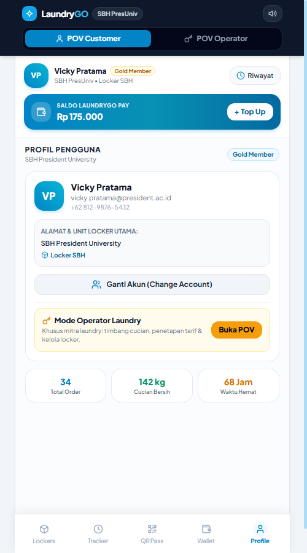
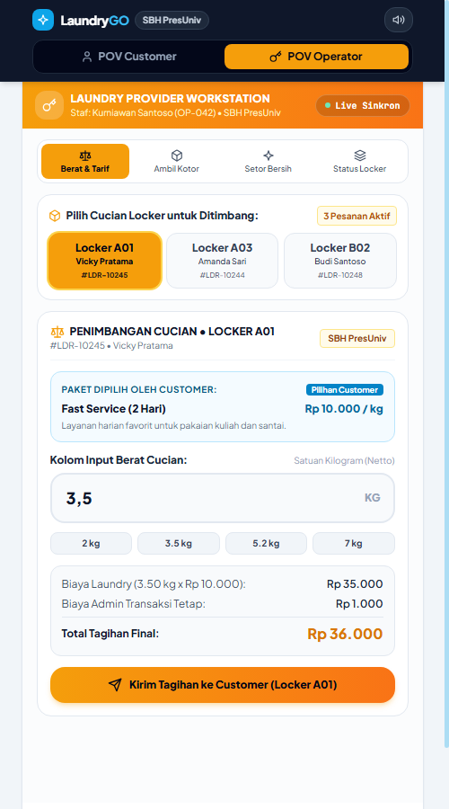
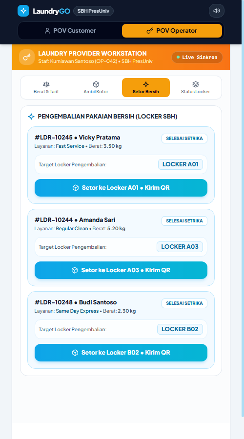
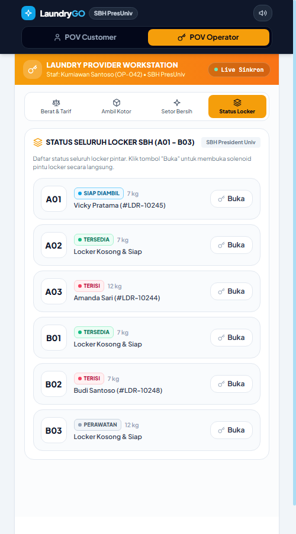

# LaundryGO Application
### Smart Laundry Locker Mobile Web Platform &mdash; SBH President University

[](https://react.dev/)
[](https://tailwindcss.com/)
[](#)
[](#)

Platform mobile web modern untuk ekosistem **Smart Laundry Locker** di **SBH President University**. Aplikasi ini dirancang *mobile-web-first* dengan tema cerah (*clean pure white & sky blue*), bebas dari bezel/phone frame tiruan, dan mendukung sinkronisasi real-time dua arah (*Live Dual POV*) antara antarmuka **Pelanggan (Customer)** dan **Petugas Laundry (Operator)**.

---

## 📸 Tampilan Antarmuka (UI Showcase)

| POV Customer &bull; Locker & Layanan | POV Customer &bull; Pelacakan & Tagihan | POV Customer &bull; Profil & Ganti Akun |
|:---:|:---:|:---:|
|  |  |  |

| POV Operator &bull; Penimbangan Cucian | POV Operator &bull; Pengembalian Bersih | POV Operator &bull; Status Seluruh Locker |
|:---:|:---:|:---:|
|  |  |  |

---

## 🌟 Fitur Utama

### 1. POV Customer (Pelanggan)
* **Pilihan Paket Layanan Mandiri**:
  * **3 Hari (Regular Clean)**: Rp 7.000 / kg
  * **2 Hari (Fast Service)**: Rp 10.000 / kg
  * **1 Hari (Same Day Express)**: Rp 15.000 / kg
  * Paket yang dipilih customer menjadi dasar perhitungan saat pakaian ditimbang oleh operator.
* **Smart Locker Grid**: Memilih locker yang tersedia (`A01`–`B03`), melakukan *drop-off* cucian kotor, atau mengambil cucian yang sudah bersih.
* **Dynamic Optical QR Pass**: Kode QR dinamis dengan sistem rotasi token 30 detik (TOTP), watermark keamanan anti-screenshot, dan timestamp real-time untuk pemindaian solenoid pintu locker.
* **Pelacakan Cucian Real-Time (Tracker)**: Memantau 5 tahapan pengerjaan laundry serta rincian biaya transparan setelah cucian ditimbang operator.
* **LaundryGO Pay (Digital Wallet)**: Top up saldo instan dan pembayaran cashless sekali klik.
* **Profil Pengguna & Switch Account**: Kartu profil pengguna umum (**Vicky Pratama**, Gold Member) dilengkapi modal antarmuka ganti akun interaktif dan akses pintas ke Mode Operator.
* **Fixed Bottom Navigation**: Menu navigasi 5-tab terkunci permanen di bagian bawah layar (*docked at bottom*), tidak terpotong saat scroll.

### 2. POV Operator (Stasiun Mitra Laundry)
* **Kepatuhan Paket Pilihan Customer (Read-Only)**: Operator tidak menetapkan paket secara sepihak, melainkan memproses pesanan sesuai paket yang telah dipilih customer.
* **Kolom Input Berat Cucian**: Operator hanya fokus menimbang dan memasukkan berat (kg) cucian netto.
* **Kalkulasi & Kirim Tagihan Otomatis**: Menghitung `(Berat kg × Tarif Paket) + Biaya Admin Rp 1.000` dan langsung menerbitkan tagihan ke tab Tracker customer.
* **Dukungan Multi-Locker Order**: Mendukung pemrosesan beberapa locker aktif sekaligus (A01 Vicky Pratama, A03 Amanda Sari, B02 Budi Santoso).
* **Sub-Tab Ambil Kotor**: Daftar cucian kotor yang perlu diambil dari locker beserta tombol buka solenoid dan cetak label barcode.
* **Sub-Tab Setor Bersih**: Pengembalian pakaian bersih ke locker tujuan dan penerbitan QR pass otomatis ke customer.
* **Sub-Tab Status Locker**: Monitoring seluruh unit locker SBH (A01–B03) dalam format *horizontal row card* yang responsif dan rapi tanpa dead space vertikal.

### 3. Hardware Prototype Bridge
* Modul [`src/services/lockerService.js`](src/services/lockerService.js) telah disiapkan sebagai lapisan abstraksi perangkat keras (*Hardware Abstraction Layer*).
* Mendukung integrasi ke mikrokontroler (ESP32, Arduino, Raspberry Pi) melalui WebSocket (`ws://<ip>:81/ws`), MQTT, REST API, maupun Web Serial.

---

## 🚀 Cara Menjalankan Aplikasi

### Opsi 1: Menjalankan Server Lokal (Disarankan)
Klik dua kali file `run_server.bat` atau jalankan via PowerShell:
```powershell
powershell -ExecutionPolicy Bypass -File .\run_server.ps1
```
* **Akses Browser**: Buka [http://localhost:8082](http://localhost:8082)
* **Akses Smartphone (Wi-Fi Lokal)**: Hubungkan HP ke Wi-Fi yang sama dan buka URL IP lokal yang tertera pada terminal.

### Opsi 2: Buka File Langsung
Aplikasi dibangun secara modular menggunakan React 18, Tailwind CSS, dan Babel Standalone sehingga file `index.html` dapat langsung dibuka dengan klik dua kali di browser apa pun tanpa memerlukan instalasi Node.js.

### Shortcut Pengujian Berdasarkan URL
* **Customer POV**: `http://localhost:8082/?mode=customer&tab=lockers`
* **Operator Mode - Status Seluruh Locker**: `http://localhost:8082/?mode=operator&opTab=lockers_overview`
* **Operator Mode - Setor Bersih**: `http://localhost:8082/?mode=operator&opTab=return`
* **Operator Mode - Input Berat & Tarif**: `http://localhost:8082/?mode=operator&opTab=weighing`
* **Customer Profile & Ganti Akun**: `http://localhost:8082/?mode=customer&tab=profile`

---

## 📁 Struktur Proyek
```
laundrygo-mobile-web/
├── index.html                   # Entry point aplikasi web standalone
├── README.md                    # Dokumentasi lengkap
├── .gitignore                   # Aturan pengabaian file Git
├── run_server.bat               # Shortcut peluncuran server Windows
├── run_server.ps1               # Server lokal HttpListener PowerShell
├── sync_build.ps1               # Skrip sinkronisasi App.jsx ke index.html
├── src/
│   ├── App.jsx                  # Komponen utama React LaundryGO
│   └── services/
│       └── lockerService.js     # Hardware & API bridge untuk prototype locker
└── screenshot_*.png             # Aset dokumentasi UI showcase
```

---

## 📄 Lisensi
Hak Cipta &copy; 2026 **LaundryGO - SBH President University**.
Dibuat untuk pengembangan sistem purwarupa Smart Laundry Locker.
